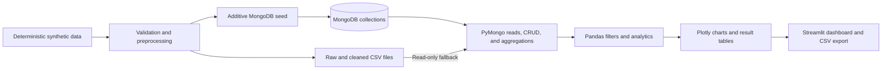

# Blood Bank Management Analytics Using MongoDB

## 1. Abstract

This project is an academic Big Data Analytics (BDA) mini project that demonstrates a data pipeline and interactive analysis for blood-bank inventory, donation, and hospital-request records. A deterministic synthetic dataset is validated and processed using Python and Pandas. MongoDB stores the documents; PyMongo connects the application to the database and executes CRUD and aggregation operations. Streamlit presents interactive results, with Plotly charts.

The dashboard compares stock with pending demand separately for each blood group, summarizes request fulfillment, displays daily, weekly, and monthly donation trends, and supports filtered review of selected records. The generated data contains 3 blood banks, 4 hospitals, 24 inventory snapshots, 500 donation records, and 500 hospital requests. The full cleaned synthetic dataset contains 2,404 inventory units, 9,277 requested units, 7,055 supplied units, and 2,222 pending units. Weighted fulfillment is 76.05%. A simplified, group-level stock-versus-pending estimate is 372 units; it is an analytical indicator and not a clinical allocation recommendation.

The project demonstrates document database use and small-scale batch analytics; it does not claim distributed processing, predictive forecasting, or deployment in a real healthcare workflow. MongoDB was verified on a local `localhost` instance. Atlas connectivity has not been verified.

## 2. Introduction

Blood services must coordinate donations, stored inventory, and hospital requests. These records have useful dimensions such as blood group, time, bank, hospital, and location. Data analysis can help summarize supply and demand, identify imbalances for further investigation, and present information consistently.

This mini project applies a practical data lifecycle: deterministic synthetic-data generation, validation and preprocessing, persistence in CSV and MongoDB, aggregation and calculation, and interactive visualization. Python provides the programming environment; Pandas provides tabular transformations; MongoDB stores documents; PyMongo provides Python database access; Plotly creates interactive figures; and Streamlit provides the dashboard interface.

The word “Big Data” in the project title refers to the BDA course context and the analytics workflow. The supplied data is a few hundred records, not a production-scale or distributed big-data workload. The project is a prototype for learning and demonstration.

## 3. Problem definition

Inventory and requests are recorded across multiple blood groups, banks, hospitals, and dates. Looking only at total stock and total pending requests can hide a group-specific shortage: stock for one group cannot simply be netted against another group's demand. A useful monitoring view therefore needs to summarize stock and demand at compatible analytical groupings, show fulfillment and trends, and let a user inspect selected data.

This project addresses the reporting problem by providing validated records and filterable summaries. It does not perform clinical transfusion matching, decide patient priority, or direct allocation.

## 4. Motivation

The motivation is to demonstrate how database and analytics tools can turn operational records into understandable summaries. The synthetic data avoids processing personal donor or patient information, while deterministic generation makes the results repeatable during tests, presentations, and viva demonstrations.

## 5. Objectives

- Generate a repeatable synthetic dataset for blood banks, hospitals, inventory, donations, and requests.
- Validate required values, identifiers, relationships, dates, blood groups, and unit consistency before accepting rows into cleaned files.
- Store and query document records in MongoDB without destructively resetting existing records during seeding.
- Provide validated inventory and hospital-request CRUD operations, with confirmation before deletion.
- Calculate inventory, demand, supply, pending units, weighted fulfillment, donation trends, and simplified group-level shortage estimates.
- Provide consistent sidebar filtering, labeled charts, summary tables, and an analytical-results export.
- Test preprocessing, analytics, data operations, and Streamlit startup.

## 6. Scope and limitations

The scope covers a local educational prototype with synthetic data, a CSV preprocessing pipeline, MongoDB document persistence and aggregations, and a Streamlit dashboard. It includes read-only CSV fallback when MongoDB is unavailable; CRUD remains available only with a live MongoDB connection.

The system is not a clinical product. It contains no real patient or donor records, authentication, role-based authorization, clinical compatibility engine, blood-component/expiry model, emergency triage, or real-time hospital integration. It does not forecast demand or optimize cross-bank transfers. Its dataset is small and synthetic, and does not demonstrate distributed data processing or real-world generalizability. MongoDB Atlas has not been configured or tested as part of the verified setup.

## 7. Background and literature review

This section is a concise technology and domain background, not a systematic survey of peer-reviewed research. World Health Organization material describes blood safety and availability as public-health concerns. This project uses that context only to motivate monitoring and coordination; it does not measure patient outcomes or claim that its synthetic results improve clinical care.

Document databases represent records as documents grouped into collections. MongoDB's document model is a practical fit for this prototype because bank, hospital, inventory, donation, and request records have distinct fields and can be queried or grouped using aggregation pipelines. MongoDB does not enforce relational foreign keys, so this implementation validates references in application logic. The database server provides storage and query/aggregation capabilities; PyMongo is the Python driver used by this application.

Pandas represents tabular data as DataFrames and is used here for preprocessing, filtering, grouping, and descriptive calculations. Python coordinates these steps and the application logic. Plotly Express builds interactive charts from calculated result tables. Streamlit executes the Python dashboard script and exposes filters, tables, charts, and management forms through a web UI. These tools do not by themselves imply distributed or “at scale” computation.

## 8. Sustainable Development Goals

- **SDG 3 — Good Health and Well-being:** the project is aligned at an educational level with the goal of making blood availability and hospital demand easier to inspect. The dashboard does not provide treatment, compatibility, or clinical allocation advice, and no health outcome is measured.
- **SDG 10 — Reduced Inequalities:** filtered comparisons by location and hospital can help identify differences for further investigation. The synthetic comparisons do not establish discrimination, unequal access, or the causes of any difference.
- **SDG 17 — Partnerships for the Goals:** the project models information associated with hospitals and blood banks and can be used to discuss data coordination. It does not represent an active partnership, shared production system, or real-world institutional agreement.

## 9. Requirements

### 9.1 Functional requirements

- Generate and preprocess the five datasets.
- Read data from MongoDB when available and use cleaned CSVs as a read-only fallback.
- Filter relevant records by date, blood group, hospital, location, and blood bank.
- Display inventory, hospital demand and fulfillment, donation trends and breakdowns, group-level demand and shortage estimates, threshold alerts, and descriptive statistics.
- Export selected analytical result tables.
- Create, update, and delete inventory and hospital-request records through MongoDB-backed forms; require explicit confirmation before deleting.
- Run MongoDB aggregation examples for inventory, donations, and hospital requests.

### 9.2 Non-functional requirements

- Deterministic synthetic data generation.
- Explicit validation and invalid-record reporting rather than silent repair.
- Safe additive seeding that does not reset or overwrite existing records.
- Database error messages that do not expose credentials.
- Readable charts and tables, and automated tests for important calculations and app startup.

## 10. System architecture

The dashboard loads the five MongoDB collections when the configured local connection is available. If it cannot connect, it displays cleaned CSV data with a warning; database management operations are not offered in read-only fallback mode. The project does not reset collections when seeding.

## 11. Database design

The MongoDB database is named `blood_bank_analytics` and contains five collections:

| Collection | Identifier | Purpose |
| --- | --- | --- |
| `blood_banks` | `bank_id` | Bank name and location metadata |
| `hospitals` | `hospital_id` | Hospital name and location metadata |
| `blood_inventory` | `inventory_id` | Available units by bank, blood group, and update date |
| `donations` | `donation_id` | Donation units, group, date, bank, and location |
| `hospital_requests` | `request_id` | Requested/supplied/pending units, group, hospital, bank, and date |

The named identifiers also serve as MongoDB `_id` values in seeded records. MongoDB enforces `_id` uniqueness; the application creates unique indexes on the named identifiers and additional query indexes. Inventory and hospital-request collections have MongoDB JSON Schema validators installed by the seeder and before UI write operations. Bank and hospital references are checked by repository validation because MongoDB does not provide relational foreign-key constraints. Additional schema examples are in [database_schema.md](./database_schema.md).

## 12. Dataset description

The deterministic synthetic generator uses a fixed NumPy random seed and produces:

| Dataset | Records |
| --- | ---: |
| Blood banks | 3 |
| Hospitals | 4 |
| Inventory snapshots | 24 |
| Donations | 500 |
| Hospital requests | 500 |

The inventory covers eight groups: A+, A−, B+, B−, AB+, AB−, O+, and O−. Bank locations are Bengaluru, Mysuru, and Hubballi; the four hospitals also include Bellary. The current donation records range from 2024-01-01 to 2025-06-30, and request records range from 2024-01-03 to 2025-06-28; inventory snapshot dates are 2025-06-30. The records are illustrative and synthetic, not measured real-world data.

## 13. Data preprocessing

`src/data_generation.py` generates raw frames and validates required fields, non-empty string IDs, duplicate rows and duplicate IDs, blood groups, units, ages, dates, request consistency, and hospital/bank references and names/locations. Invalid records are excluded from the cleaned frame and reported with reasons; the pipeline does not clip invalid values into apparently valid records. Cleaned dates and numeric columns are converted to appropriate Pandas types before CSV output.

The current deterministic generated data has no rejected, duplicate, or missing records:

| Dataset | Before | After | Removed | Duplicate rows | Missing cells | Invalid rows |
| --- | ---: | ---: | ---: | ---: | ---: | ---: |
| `blood_banks` | 3 | 3 | 0 | 0 | 0 | 0 |
| `hospitals` | 4 | 4 | 0 | 0 | 0 | 0 |
| `blood_inventory` | 24 | 24 | 0 | 0 | 0 | 0 |
| `donations` | 500 | 500 | 0 | 0 | 0 | 0 |
| `hospital_requests` | 500 | 500 | 0 | 0 | 0 | 0 |

The pipeline reports actual counts when run; these numbers refer to the generated dataset verified for this report.

## 14. MongoDB implementation

The application uses PyMongo and the environment-based `MONGODB_URI` and `MONGODB_DB` settings; defaults are `mongodb://localhost:27017` and `blood_bank_analytics`. The verified connection is the local MongoDB instance only. Atlas has not been verified.

`src/db/seed.py` validates and seeds additively with `$setOnInsert`, so it inserts missing identifiers and preserves documents already present under matching IDs. It does not reset collections. The repository module validates inventory and request create/update payloads, derives request pending/status/fulfillment values, checks references, and requires `confirmed=True` for delete operations. The Streamlit interface exposes inventory and hospital-request CRUD only when MongoDB is connected. MongoDB exceptions shown to users are sanitized to avoid exposing connection credentials.

MongoDB aggregation pipeline examples in the project calculate inventory totals by bank and group, donation totals by month, and hospital request/supply/pending totals and fulfillment by hospital. Dashboard analytics themselves use one loaded record source and Pandas transformations, so the displayed selected-data KPIs and charts agree.

## 15. Analytics methodology and formulas

The sidebar filters apply consistently to relevant records and results. Donation dates filter donation records, request dates filter request records, and `last_updated` filters inventory snapshots. Blood group and bank/location filters apply where those fields exist; hospital filters apply to requests. KPIs, charts, tables, and export are calculated from the resulting selected records.

- **Total available inventory:** sum of selected `available_units`.
- **Total demand / supply / pending:** sums of selected `requested_units`, `supplied_units`, and `pending_units`.
- **Weighted fulfillment percentage:** total supplied units ÷ total requested units × 100. This is calculated from sums, not an unweighted mean of per-request percentages.
- **Donation trend:** sum of `donation_units` per calendar day, Monday-starting week, or calendar month.
- **Donation breakdown:** sum of donation units and count of records, grouped by blood group, blood bank, or location.
- **Group inventory share:** group available units ÷ total selected available units × 100.
- **Estimated shortage by group:** max(group pending units − group available units, 0); total estimated shortage is the sum of group estimates.
- **Low-stock alert:** a selected bank/group inventory record with available units less than or equal to the user-selected threshold; default threshold is 100 units.
- **Descriptive statistics:** mean, median, minimum, maximum, and sample standard deviation (ddof=1) computed over individual selected inventory, donation, or request records as labelled.
- **Top hospitals:** hospital groups ranked by total requested units; “greatest shortages” ranks groups with positive simplified estimates.

The shortage estimate does not account for compatibility rules, component type, expiry, timing, location/logistics, transfer constraints, or clinical priority. It is not a clinical allocation recommendation.

## 16. Results and interpretation

The following values were recalculated from the current cleaned CSV files using the project analytics implementation, with all filters set to “All” and a 100-unit low-stock threshold.

### 16.1 Overall results

| Measure | Result |
| --- | ---: |
| Available inventory | 2,404 units |
| Requested | 9,277 units |
| Supplied | 7,055 units |
| Pending | 2,222 units |
| Weighted fulfillment | 76.05% |
| Donations | 990 units across 500 records |
| Estimated group-level shortage | 372 units |
| Low-stock inventory records at ≤100 units | 11 of 24 |

### 16.2 Blood-group stock, demand, and estimated shortage

| Blood group | Inventory units | Inventory share | Requested units | Supplied units | Pending units | Fulfillment | Estimated shortage |
| --- | ---: | ---: | ---: | ---: | ---: | ---: | ---: |
| O− | 375 | 15.60% | 1,430 | 1,115 | 315 | 77.97% | 0 |
| O+ | 351 | 14.60% | 2,215 | 1,668 | 547 | 75.30% | 196 |
| AB+ | 329 | 13.69% | 1,110 | 815 | 295 | 73.42% | 0 |
| B− | 313 | 13.02% | 545 | 426 | 119 | 78.17% | 0 |
| AB− | 311 | 12.94% | 568 | 433 | 135 | 76.23% | 0 |
| B+ | 294 | 12.23% | 1,282 | 933 | 349 | 72.78% | 55 |
| A− | 231 | 9.61% | 646 | 505 | 141 | 78.17% | 0 |
| A+ | 200 | 8.32% | 1,481 | 1,160 | 321 | 78.33% | 121 |

O− has the highest aggregate stock; A+ has the lowest. The simplified comparison identifies positive shortfalls for O+, A+, and B+. These totals flag differences for analysis only; they do not indicate that stock is clinically interchangeable or immediately available at the hospital needing it.

### 16.3 Donation results

Donation totals by group are O+ 229 units (114 records), A+ 199 (100), B+ 165 (80), O− 154 (79), AB+ 77 (34), A− 74 (43), B− 60 (34), and AB− 32 (16). The highest monthly total is 79 units in March 2024; the highest daily total is 10 units on 2024-09-08; and the highest Monday-starting weekly total is 28 units in the week beginning 2024-06-10.

By blood bank/location, the records show CarePlus Blood Bank / Hubballi: 343 units across 169 records; Mercy Blood Centre / Mysuru: 332 units across 167 records; and Lifeline Blood Bank / Bengaluru: 315 units across 164 records.

### 16.4 Hospital demand

| Hospital | Requested units | Supplied units | Pending units | Weighted fulfillment |
| --- | ---: | ---: | ---: | ---: |
| CityCare General Hospital | 2,669 | 2,117 | 552 | 79.32% |
| Metro Trauma Center | 2,426 | 1,831 | 595 | 75.47% |
| Rural Care Hospital | 2,101 | 1,528 | 573 | 72.73% |
| Green Valley Hospital | 2,081 | 1,579 | 502 | 75.88% |

CityCare has the highest requested volume; Metro Trauma Center has the highest pending volume. Differences are descriptive properties of synthetic records and do not explain why demand or fulfillment differs.

### 16.5 Descriptive statistics

| Measure per record | n | Mean units | Median | Minimum | Maximum | Sample SD |
| --- | ---: | ---: | ---: | ---: | ---: | ---: |
| Inventory per bank/group snapshot | 24 | 100.17 | 104.50 | 59 | 132 | 20.43 |
| Donation units per donation record | 500 | 1.98 | 2.00 | 1 | 3 | 0.80 |
| Requested units per request | 500 | 18.55 | 18.00 | 4 | 37 | 8.15 |
| Supplied units per request | 500 | 14.11 | 14.00 | 0 | 34 | 7.15 |
| Pending units per request | 500 | 4.44 | 4.00 | 0 | 15 | 3.26 |

## 17. Visualizations

The Streamlit **Analytics results** section contains:

- KPI cards for inventory, demand, supply, pending units, weighted fulfillment, and estimated shortage.
- Inventory distribution by blood group and blood bank, plus threshold-based low-stock alerts.
- Hospital demand, supply, pending-unit, and weighted-fulfillment comparisons.
- Blood-group demand and simplified shortage comparison.
- Daily, weekly, and monthly donation trends.
- Donation breakdowns by blood group, bank, and location.
- Top hospitals, groups with the greatest estimated shortage, and descriptive statistics.
- A ZIP download of CSV result tables. The same filters are used for relevant visualizations, tables, and exported results.

## 18. Testing

The test suite is in `tests/test_data_generation.py` and uses pytest plus Streamlit `AppTest`. It covers deterministic generation and record validity, preprocessing summaries and rejection of invalid records, CRUD validation and persistence using in-memory test collections, MongoDB aggregation pipeline filter construction, donation trend grouping, shortage and weighted fulfillment calculations, date/category filters, low-stock threshold behavior, KPI/chart-table consistency, export contents, and app startup without exceptions.

Final verification for this documentation phase:

- `python3 -m pytest -q`: **19 passed**.
- `python3 -m compileall -q src tests`: completed successfully.
- The verification commands did not reset, seed, or otherwise write to MongoDB.

## 19. Limitations

- Data is synthetic and small; statistical patterns cannot be generalized to real services.
- The shortage calculation is a simplified group-level arithmetic comparison, not clinical advice or an allocation algorithm.
- Inventory is represented as current bank/group snapshots; stock age, expiry, and component type are not modelled.
- There is no predictive model, real-time ingestion, production authentication, authorization, or live hospital integration.
- MongoDB deployment verification covers local MongoDB only; Atlas has not been tested.
- The application demonstrates local-scale analytics, not distributed BDA infrastructure.

## 20. Conclusion

The project demonstrates a reproducible pipeline from synthetic-data generation and validation to MongoDB storage, Python/Pandas analysis, and an interactive Streamlit dashboard. It reports consistent selected-data KPIs and exposes daily, weekly, monthly, group, bank, hospital, and location summaries. The calculations and interface are covered by an automated test suite. The application is an academic prototype; its synthetic findings and simplified shortage estimates must not be used for clinical or operational allocation decisions.

## 21. Future enhancements

- Validate requirements and performance with a real institution-approved dataset under appropriate privacy and governance controls.
- Add stock expiry and component-level inventory representation.
- Explore and separately validate a forecasting model before describing the project as predictive.
- Add authenticated roles, audit trails, and deployment security before considering operational use.
- Test a secured MongoDB Atlas environment and document deployment evidence if cloud hosting is required.
- Evaluate scalability with a specified benchmark and appropriate distributed processing only if the project scope requires it.

## 22. References

The references below are official documentation or public guidance used for the technology descriptions and project context. No unverified research papers or experimental claims are cited.

1. World Health Organization, “Blood safety and availability,” public health fact sheet: <https://www.who.int/news-room/fact-sheets/detail/blood-safety-and-availability>.
2. United Nations, “Goal 3: Ensure healthy lives and promote well-being for all at all ages”: <https://sdgs.un.org/goals/goal3>.
3. United Nations, “Goal 10: Reduce inequality within and among countries”: <https://sdgs.un.org/goals/goal10>.
4. United Nations, “Goal 17: Strengthen the means of implementation and revitalize the Global Partnership for Sustainable Development”: <https://sdgs.un.org/goals/goal17>.
5. MongoDB, “Documents”: <https://www.mongodb.com/docs/manual/core/document/>.
6. MongoDB, “Aggregation Operations”: <https://www.mongodb.com/docs/manual/aggregation/>.
7. MongoDB, “PyMongo documentation”: <https://www.mongodb.com/docs/languages/python/pymongo-driver/current/>.
8. Python Software Foundation, “Python Documentation”: <https://docs.python.org/3/>.
9. pandas, “User Guide”: <https://pandas.pydata.org/docs/user_guide/>.
10. Plotly, “Plotly Express”: <https://plotly.com/python/plotly-express/>.
11. Streamlit, “Documentation”: <https://docs.streamlit.io/>.
